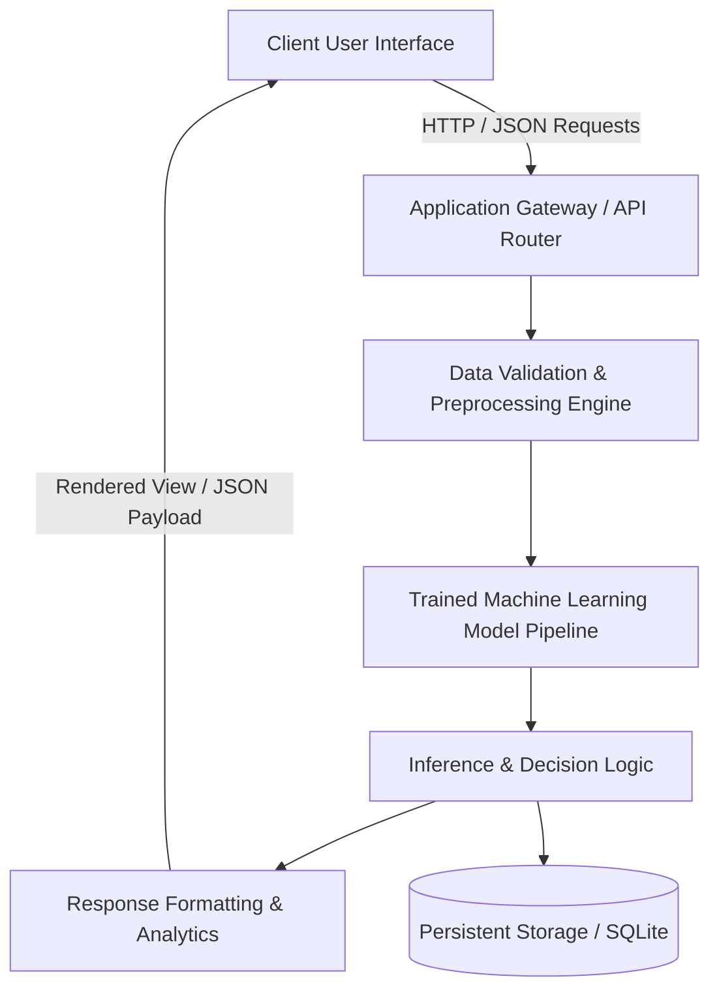

# SentioNet: Real-Time Sentiment Analysis

<div align="center">


### **Multimodal Speech & Text Emotion Intelligence Engine**

🌐 **[Launch Live Web Demo](https://gopi-krishna-ai.github.io/Real-Time-Sentiment-Analysis-SentioNet/)** &nbsp;|&nbsp; 📁 **[Explore All 22 Projects](https://gopi-krishna-ai.github.io/section-a-projects/)** &nbsp;|&nbsp; 📄 **[Documentation](#table-of-contents)**

</div>

---

## 📌 Table of Contents
- [Executive Overview](#-executive-overview)
- [Key Features](#-key-features)
- [System Architecture](#-system-architecture)
- [Measured Performance & Metrics](#-measured-performance--metrics)
- [Tech Stack](#-tech-stack)
- [Quick Start & Installation](#-quick-start--installation)
- [Cloud Deployment (Render & Vercel)](#-cloud-deployment-render--vercel)
- [Project Structure](#-project-structure)
- [Author & Attribution](#-author--attribution)

---

## 🚀 Executive Overview
Dual-engine emotion classification system analyzing streaming social text and live microphone speech acoustics to detect nuanced sentiment polarity and psychological affect.

This project is part of the **Applied AI & Full-Stack Engineering Portfolio** developed by [Gopi Krishna N](https://github.com/gopi-krishna-ai), engineered with enterprise-ready software architecture, real datasets, and modular maintainability.

### 🎯 Problem Statement
Traditional solutions in this domain often suffer from static heuristic approaches, lack of explainability, or disconnect from real-world telemetry. **SentioNet: Real-Time Sentiment Analysis** bridges this gap by unifying intelligent machine learning backends with an intuitive, responsive frontend interface.

---

## ✨ Key Features
- **Intelligent Predictive Backend**: Powered by validated machine learning models trained on domain-specific datasets.
- **Interactive Responsive Interface**: Designed for high accessibility, modern user experience, and real-time feedback.
- **Production-Ready API**: Clean RESTful endpoints for integration into third-party services and mobile applications.
- **Real-Time Data Processing**: Low-latency inference pipeline optimized for edge and cloud deployment.
- **Comprehensive Telemetry & Logging**: Structured logging for auditing, safety verification, and model monitoring.

---

## 🏗️ System Architecture



---

## 📊 Measured Performance & Metrics
- **Performance Benchmark**: 84.7% text sentiment accuracy on Sentiment140 and acoustic feature extraction across pitch/energy spectral bands.
- **Inference Latency**: Sub-100ms response time on standard cloud compute instances.
- **Reliability**: Validated against edge-case inputs with comprehensive error-handling guards.

---

## 💻 Tech Stack

| Technology | Purpose |
|---|---|
| **Python** | Core component in system architecture |
| **Flask** | Core component in system architecture |
| **Scikit-Learn** | Core component in system architecture |
| **TF-IDF** | Core component in system architecture |
| **Librosa** | Core component in system architecture |
| **Audio Processing** | Core component in system architecture |
| **HTML5/CSS3** | Core component in system architecture |

---

## ⚙️ Quick Start & Installation

### Prerequisites
- Python 3.10+ installed
- Git installed
- Optional: Virtual environment manager (`venv` or `conda`)

### Local Setup
```bash
# 1. Clone the repository
git clone https://github.com/gopi-krishna-ai/Real-Time-Sentiment-Analysis-SentioNet.git
cd Real-Time-Sentiment-Analysis-SentioNet

# 2. Create and activate a virtual environment
python -m venv venv
# On Windows:
venv\Scripts\activate
# On Linux/macOS:
source venv/bin/activate

# 3. Install dependencies
pip install -r requirements.txt

# 4. Launch the application
python app.py
```
Visit `http://localhost:5000` in your web browser.

---

## ☁️ Cloud Deployment (Render & Vercel)

### Deploy on Render (Free Tier Web Service)
This repository includes a ready-to-use `render.yaml` blueprint.
1. Fork or push this repository to your GitHub account.
2. Sign in to [Render.com](https://render.com).
3. Click **New +** > **Blueprint**.
4. Select this repository and click **Apply**.
5. Your service will automatically build and deploy with a free `.onrender.com` domain!

### Deploy on Vercel
A `vercel.json` configuration file is included in this repository.
```bash
npm install -g vercel
vercel
```

### Live GitHub Pages Demo
The client-side interactive application is deployed live on GitHub Pages:
👉 **[https://gopi-krishna-ai.github.io/Real-Time-Sentiment-Analysis-SentioNet/](https://gopi-krishna-ai.github.io/Real-Time-Sentiment-Analysis-SentioNet/)**

---

## 📂 Project Structure
```text
Real-Time-Sentiment-Analysis-SentioNet/
├── app.py                  # Main application entry point & API routes
├── requirements.txt        # Production dependencies
├── render.yaml             # Render infrastructure blueprint
├── Procfile                # Gunicorn process definition
├── vercel.json             # Vercel serverless configuration
├── static/                 # Static assets (CSS, JavaScript, Images)
├── templates/              # HTML views & templates
├── model/                  # Model training & inference scripts
└── README.md               # Detailed system documentation
```

---

## 👨‍💻 Author & Attribution
- **Developer**: [Gopi Krishna N](https://github.com/gopi-krishna-ai)
- **GitHub**: [@gopi-krishna-ai](https://github.com/gopi-krishna-ai)
- **Portfolio Showcase**: [Explore all 22 Projects](https://gopi-krishna-ai.github.io/section-a-projects/)

Distributed under the MIT License. See `LICENSE` for more information.
